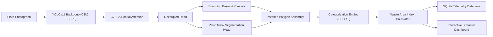

# 🍲 FOODWISE AI: AI-Based Food Waste Detection and Categorization System Using YOLOv11 Instance Segmentation

[](https://www.python.org/)
[](https://pytorch.org/)
[](https://github.com/ultralytics/ultralytics)
[](https://streamlit.io/)
[](https://sdgs.un.org/goals/goal12)

---

## 1. Project Overview & Motivation

Food waste in institutional dining halls, college cafeterias, hostels, and catering services represents a major economic and ecological crisis. Traditional waste management aggregates leftover food into generic bins without identifying:
1. **Which specific food items** are frequently discarded (e.g. rice, poultry, salads, pasta).
2. **The exact proportion of returned leftovers** relative to plate capacity.
3. **Contamination by non-edible materials** (napkins, toothpicks, cutlery).

**FOODWISE AI** is an intelligent computer vision system that audits photographs of returned cafeteria plates. Utilizing **YOLOv11 Instance Segmentation**, the system detects plates, utensils, and food ingredients, classifies them into standardized SDG 12 categories, generates polygon segmentation masks, and computes the **Paper-Based Food Waste Area Index (%)**.

### 1.1 Academic Research Reference
This project reproduces and extends the research methodology published in:
> **"Food Waste Detection in Canteen Plates Using YOLOv11"**  
> *João Ferreira, Paulino Cerqueira, Jorge Ribeiro*  
> **MDPI Applied Sciences 2025**, 15(13), 7137.  
> DOI: [10.3390/app15137137](https://doi.org/10.3390/app15137137)

### 1.2 UN Sustainable Development Goals Alignment
- **Primary Goal — SDG 12 (Target 12.3):** Halve per capita global food waste at retail and consumer levels by 2030.
- **Secondary Goal — SDG 2 (Zero Hunger):** Better food inventory control and institutional redistribution.
- **Secondary Goal — SDG 13 (Climate Action):** Mitigating methane emissions resulting from landfill food decomposition.

---

## 2. System Architecture



---

## 3. Dataset: Roboflow PROJ3 (Version 6)

Acquired directly from Roboflow Universe (`project-eyfif/proj3-food-waste-detection`):
- **Total Images:** 160 cafeteria plates (117 train, 35 validation, 8 test) at 640 × 640 resolution.
- **Annotations:** 1,150 fine-grained polygon instances across 85 distinct classes.
- **Target Ingredients:** Explicitly includes `rice` (Class 63, 76 instances in 55 images), `chicken` (Class 18), `plate` (Class 58), `french fries`, `salad`, `fish`, `pasta`, `soup`, and utensil classes (`fork`, `knife`, `spoon`).

---

## 4. Leftover Food Waste Area Estimation Formula

$$\text{Food Waste Area Index (\%)} = \frac{\text{Area}_{\text{Food}}}{\text{Area}_{\text{Plate}} - \text{Area}_{\text{Garbage}}} \times 100$$

### 4.1 Strict Algorithmic Safeguards
1. **Overlap Deduplication:** Uses boolean pixel-wise raster union ($\bigcup M_{\text{food}}$) to eliminate double-counting of layered food.
2. **Minimum Plate Area:** Requires plate area $\ge 1000\text{ px}$.
3. **Missing Plate Fallback:** Gracefully defaults to $0.0\%$ with a warning if no plate is detected.
4. **Utensil Exclusion:** Cutlery (forks, knives, spoons), cups, and napkins are excluded from the food numerator.
5. **Garbage Subtraction:** Inedible items on the plate (bones, toothpicks) are subtracted from the usable plate denominator.
6. **Division-by-Zero Guard:** A numerical tolerance ($\epsilon = 1\text{ px}$) prevents division by zero.
7. **Negative Denominator Protection:** Clamps denominator if garbage area occludes more than the plate area.
8. **Percentage Bounding:** Strictly clamps output within $[0.0\%, 100.0\%]$.
9. **Single Plate Association:** Assigns food items to their containing plate polygon.

> **Scientific Transparency Note:** The system measures 2D pixel surface area. Estimating physical mass (grams) from a single 2D photograph without 3D depth sensors (LiDAR/RGB-D) is scientifically invalid because flat food smears and tall food mounds have identical 2D surface areas but vastly different volumes and weights.

---

## 5. Project Directory Layout

```
D:\CNN PROJECT
├── app/
│   ├── components/
│   │   ├── image_utils.py          # Sample plate loader and mask cluster visualizer
│   │   └── ui_elements.py          # Cards, CSS styles, and waste badges
│   ├── pages/
│   │   ├── home.py                 # Page 1: Overview & Methodology
│   │   ├── detection.py            # Page 2: Interactive Plate Waste Detection
│   │   ├── analytics.py            # Page 3: Waste Analytics Dashboard
│   │   ├── model_info.py           # Page 4: Model Architecture & Metrics
│   │   └── sdg_impact.py           # Page 5: Sustainability & SDG 12 Impact
│   └── streamlit_app.py            # Main Streamlit application entrypoint
├── data/
│   ├── processed/
│   │   └── dataset.yaml            # Ultralytics dataset configuration
│   ├── raw/
│   │   └── roboflow/               # PROJ3 v6 images and polygon labels
│   └── foodwise.db                 # SQLite telemetry database
├── models/
│   ├── best.pt                     # Best fine-tuned YOLOv11 checkpoint
│   ├── last.pt                     # Last training checkpoint
│   └── yolov11-x-weights-v6.pt     # Ferreira et al. (2025) benchmark weights
├── reports/
│   ├── class_distribution.png      # Top 30 class distribution plot
│   ├── dataset_audit.md            # Comprehensive dataset audit
│   ├── model_evaluation.md         # Academic evaluation report
│   ├── project_methodology.md      # Detailed technical methodology report
│   ├── viva_preparation.md         # 30 Technical Viva Voce Q&As
│   └── predictions/                # Output visual prediction overlays
├── scripts/
│   ├── download_dataset.py         # Roboflow dataset acquisition script
│   ├── evaluate.py                 # Evaluation launcher script
│   ├── run_app.py                  # Streamlit application runner
│   └── train.py                    # Training launcher script
├── src/
│   ├── analysis/                   # Waste area calculator with safeguards
│   ├── config/                     # 85-class mapping to 9 broad SDG 12 categories
│   ├── data/                       # Preprocessing and augmentation pipelines
│   ├── database/                   # SQLite database manager
│   ├── evaluation/                 # Metrics and evaluation logic
│   ├── inference/                  # End-to-end predictor pipeline
│   ├── models/                     # YOLOv11 model wrapper
│   └── training/                   # Local training engine
├── tests/                          # Full unit and integration test suite
├── config.yaml                     # Global configuration
├── requirements.txt                # Python dependencies
└── README.md                       # Complete project documentation
```

---

## 6. Installation & Execution Guide

### 6.1 Setup Environment
```bash
# Clone or navigate to the project directory
cd "D:\CNN PROJECT"

# Install dependencies
pip install -r requirements.txt
```

### 6.2 Train YOLOv11 Model (Locally)
```bash
# Train for 30 epochs on CPU/GPU
python scripts/train.py --model yolo11n-seg.pt --epochs 30 --batch 4
```

### 6.3 Run Model Evaluation on Test Split
```bash
# Evaluate checkpoint on test set and generate reports
python scripts/evaluate.py --model models/best.pt --split test
```

### 6.4 Launch the Streamlit Application
```bash
# Launch interactive 5-page dashboard
streamlit run app/streamlit_app.py
# or
python scripts/run_app.py
```

### 6.5 Run the Test Suite
```bash
python -m unittest discover tests
```

---

## 7. 5-Page Streamlit Dashboard Walkthrough

1. **🏠 Overview & Methodology:** Research context, SDG 12.3 alignment, and YOLOv11 technical workflow.
2. **🔍 Plate Waste Detection:** Drag-and-drop plate photograph upload or benchmark plate selection; live inference with annotated overlays, mask clustering, KPI cards, itemized ingredient table, and SQLite logging.
3. **📊 Waste Analytics Dashboard:** Key metrics (total plates, average waste %, clean plate rate), temporal trend line charts, category pie charts, and one-click CSV export.
4. **🧠 Model Architecture & Metrics:** Deep dive into C3k2, SPPF, C2PSA, Proto heads, PROJ3 dataset audit graphs, and formal evaluation tables.
5. **🌍 Sustainability & SDG 12:** Real-world cafeteria impact, dynamic portion control, inventory optimization, and 3D depth sensor considerations.

---

## 8. Authors & Academic Citation
```bibtex
@article{ferreira2025foodwaste,
  title={Food Waste Detection in Canteen Plates Using YOLOv11},
  author={Ferreira, Jo{\~a}o and Cerqueira, Paulino and Ribeiro, Jorge},
  journal={Applied Sciences},
  volume={15},
  number={13},
  pages={7137},
  year={2025},
  publisher={MDPI},
  doi={10.3390/app15137137}
}
```

