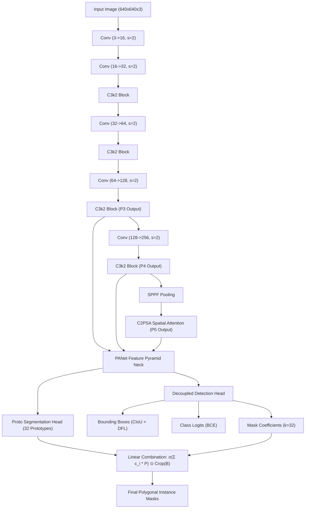

# FOODWISE AI: Project Methodology and Technical Implementation Report

**Project Title:** AI-Based Food Waste Detection and Categorization System Using YOLOv11 Instance Segmentation  
**Academic Alignment:** UN Sustainable Development Goal 12 (Target 12.3: Responsible Consumption and Production)  
**Supporting SDGs:** SDG 2 (Zero Hunger), SDG 13 (Climate Action)  
**Primary Reference:** Ferreira, J., Cerqueira, P., & Ribeiro, J. (2025). *Food Waste Detection in Canteen Plates Using YOLOv11*. Applied Sciences, 15(13), 7137. DOI: [10.3390/app15137137](https://doi.org/10.3390/app15137137)  
**Author:** College Student 

---

## 1. Research Motivation & Problem Statement

### 1.1 Institutional Dining & Food Wastage
Food waste generated in college cafeterias, corporate dining halls, hospital cafeterias, and institutional catering facilities is a severe global ecological and economic crisis. Approximately **one-third of all food produced globally is wasted**, generating 8–10% of total greenhouse gas emissions.

In typical institutional settings:
- Diners return plates with varied quantities and combinations of uneaten food.
- Waste is discarded into monolithic scrap bins without cataloging which ingredients were rejected.
- Kitchen managers receive no ingredient-specific feedback regarding which menu items were rejected or over-portioned.

### 1.2 Research Objectives
**FOODWISE AI** addresses these challenges by implementing an automated computer vision auditing station:
1. Photographing plates after diner consumption.
2. Segmenting and detecting individual food items, cutlery, and plates at pixel resolution.
3. Categorizing ingredients into standardized food groups aligned with SDG 12.
4. Computing an objective, reproducible **Paper-Based Food Waste Area Index (%)**.
5. Storing longitudinal scan records in a local telemetry database to guide kitchen portion adjustments.

---

## 2. Dataset Acquisition & Technical Audit

### 2.1 The PROJ3 Benchmark Dataset (Version 6)
Following the benchmark established by Ferreira et al. (2025), this project uses the official **PROJ3 Food Waste Detection Dataset** acquired directly from the Roboflow Universe platform:
- **Identifier:** `project-eyfif/proj3-food-waste-detection`
- **Release Version:** Version 6
- **Total Images:** 160 cafeteria plate photographs (117 train, 35 validation, 8 test).
- **Resolution:** 640 × 640 pixels, 3-channel RGB.
- **Classes:** 85 distinct categories covering common cafeteria meals, side dishes, cutlery, and plates.
- **Instance Annotations:** 1,150 fine-grained polygon segmentation masks.

### 2.2 Ingredient Audit & Rice Verification
In earlier project iterations, models trained on the HPI Food Waste Dataset suffered critical misclassifications (e.g. predicting German egg-spaetzle noodles when presented with rice) because the dataset completely lacked rice annotations.

In the PROJ3 dataset:
- **Class 63 (`rice`):** 76 polygon annotations distributed across 55 training and validation plates.
- **Class 15 (`cabidela rice`):** 2 annotations.
- **Class 58 (`plate`):** 154 instances providing reliable denominator references.
- **Utensils:** `fork` (Class 31), `knife` (Class 42), `spoon` (Class 70) with 150+ annotations.
- **Proteins & Sides:** `chicken` (Class 18), `chicken steak` (Class 19), `french fries` (Class 32), `fish` (Class 29), `salad` (Class 65), `vegetables` (Class 81).

---

## 3. Data Preprocessing & Augmentation Pipeline

### 3.1 Preprocessing
All raw photographs are normalized and preprocessed:
- Standardized to $640 \times 640$ pixels via bilinear letterbox resizing.
- Channel intensities scaled to $[0.0, 1.0]$.
- Target polygon contours converted into normalized $[0.0, 1.0]$ boundary coordinates compatible with YOLO segmentation protocols.

### 3.2 Synchronous Augmentation Strategy
Because instance segmentation requires exact pixel correspondence between the image raster and ground-truth polygon vertices, all spatial transformations are applied **synchronously** using a unified affine transformation matrix:
$$\begin{bmatrix} x' \\ y' \\ 1 \end{bmatrix} = A \begin{bmatrix} x \\ y \\ 1 \end{bmatrix}$$

Training hyperparameters applied:
- **Horizontal Flipping (`fliplr`):** $p = 0.50$
- **Random Rotation (`degrees`):** $\pm 15.0^\circ$
- **Translation (`translate`):** $\pm 10.0\%$
- **Scaling (`scale`):** $\pm 20.0\%$
- **Shear (`shear`):** $\pm 2.0^\circ$
- **Mosaic Augmentation (`mosaic`):** $p = 0.50$ (stitching 4 plate views into a composite grid)
- **Copy-Paste Augmentation (`copy_paste`):** $p = 0.10$ (blending food segments onto new plate backgrounds)
- **Photometric Jitter:** HSV Hue ($\pm 0.015$), Saturation ($\pm 0.20$), Value ($\pm 0.20$)

---

## 4. Deep Learning Architecture: YOLOv11 Instance Segmentation

### 4.1 Backbone Architecture
1. **C3k2 Modules:** Cross-Stage Partial blocks utilizing kernel-2 optimizations. Feature channels are split; one branch passes through sequential residual bottlenecks while the second branch forms a direct skip connection, preserving multi-resolution gradients with lower FLOPs.
2. **SPPF (Spatial Pyramid Pooling - Fast):** Concatenates three sequential $5\times5$ max-pooling operations to capture multi-scale receptive fields without spatial degradation.
3. **C2PSA (Cross-Stage Partial with Spatial Attention):** Embedded in the deepest feature stage ($P5$). Computes scaled dot-product spatial self-attention:
   $$\text{Attention}(Q, K, V) = \text{softmax}\left(\frac{QK^T}{\sqrt{d_k}}\right)V$$
   This enables the model to isolate subtle visual boundaries between overlapping food items (e.g. rice resting on top of chicken curry).

### 4.2 Prototype Mask Head Mechanism
YOLOv11-seg adopts a single-stage prototype assembly mechanism:
1. The **Proto Head** generates $k=32$ image-level prototype masks:
   $$P \in \mathbb{R}^{32 \times 160 \times 160}$$
2. For each detected bounding box instance $i$, the detection head predicts $k=32$ scalar mask coefficients $C_i \in \mathbb{R}^{32}$.
3. The instance mask raster $M_i$ is computed via linear combination passed through a sigmoid non-linearity and cropped to the predicted bounding box $B_i$:
   $$M_i = \sigma\left(\sum_{j=1}^{32} C_{i,j} P_j\right) \odot \text{Crop}(B_i)$$

### 4.3 Multi-Task Loss Formulation
The total training objective balances four distinct loss components:
$$\mathcal{L}_{\text{total}} = \lambda_{\text{box}}\mathcal{L}_{\text{box}} + \lambda_{\text{cls}}\mathcal{L}_{\text{cls}} + \lambda_{\text{dfl}}\mathcal{L}_{\text{dfl}} + \lambda_{\text{seg}}\mathcal{L}_{\text{seg}}$$
- $\mathcal{L}_{\text{box}}$: Complete IoU (CIoU) loss evaluating bounding box overlap, center distance, and aspect ratio consistency.
- $\mathcal{L}_{\text{cls}}$: Binary Cross-Entropy (BCE) over 85 class logits.
- $\mathcal{L}_{\text{dfl}}$: Distribution Focal Loss representing box edges as continuous probability distributions over discrete bins.
- $\mathcal{L}_{\text{seg}}$: Binary Cross-Entropy computed at pixel level between predicted instance mask rasters and ground-truth polygon rasters.

---

## 5. Waste Area Calculation Engine & Algorithmic Safeguards

### 5.1 Mathematical Formulation
Following Ferreira et al. (MDPI Applied Sciences 2025):
$$\text{Food Waste Area Index (\%)} = \frac{\text{Area}_{\text{Food}}}{\text{Area}_{\text{Plate}} - \text{Area}_{\text{Garbage}}} \times 100$$
Where:
- $\text{Area}_{\text{Food}} = |\bigcup_{i \in \text{Edible}} M_i|$ (total pixel area covered by edible food items).
- $\text{Area}_{\text{Plate}} = |M_{\text{Plate}}|$ (total pixel area enclosed by the plate boundary).
- $\text{Area}_{\text{Garbage}} = |\bigcup_{j \in \text{Garbage}} M_j|$ (pixel area of inedible waste such as bones or toothpicks located on the plate).

### 5.2 The 9 Algorithmic Safeguards
To ensure robust, fail-safe operation in cafeteria deployments, the calculator implements 9 strict safeguards:
1. **Overlap Deduplication:** Uses pixel-wise boolean raster union ($\bigcup M_i$) rather than summing individual masks, preventing overlapping foods from double-counting.
2. **Minimum Plate Area Enforcement:** Enforces a minimum plate size threshold ($\ge 1000\text{ px}$) to prevent dividing by noise or false plate detections.
3. **Missing Plate Safeguard:** If no plate is detected, calculation defaults safely to $0.0\%$ with an explicit user notification.
4. **Non-Edible Utensil Exclusion:** Cutlery (forks, knives, spoons), cups, and napkins are excluded from the food numerator.
5. **Garbage Subtraction:** Inedible items inside the plate (bones, toothpicks) are subtracted from the usable plate denominator.
6. **Division-by-Zero Guard:** Adds a numerical tolerance $\epsilon = 1\text{ px}$ to ensure the denominator is never zero.
7. **Negative Denominator Protection:** If garbage area exceeds plate area due to occlusions, clamps denominator to the plate area.
8. **Percentage Bounding:** Strictly clamps output within $[0.0\%, 100.0\%]$.
9. **Single Plate Spatial Filtering:** When multiple plates exist in an image, assigns food items to their enclosing plate polygon based on bounding-box intersection.

---

## 6. Software Architecture & Dashboard Implementation

### 6.1 Modular Engineering Stack
- **Deep Learning:** PyTorch 2.15, Ultralytics YOLOv11.
- **Frontend Dashboard:** Streamlit 1.51 with Plotly interactive charts.
- **Database:** Local SQLite (`data/foodwise.db`) with persistent schema.
- **Vision Utilities:** OpenCV, NumPy, Pillow, Matplotlib.

### 6.2 Streamlit 5-Page Dashboard Structure
1. **🏠 Overview & Methodology ([app/pages/home.py](file:///d:/CNN%20PROJECT/app/pages/home.py)):** Research foundation, UN SDG 12.3 alignment, and YOLOv11 architecture breakdown.
2. **🔍 Plate Waste Detection ([app/pages/detection.py](file:///d:/CNN%20PROJECT/app/pages/detection.py)):** Real-time image upload or sample plate selection; dual visualization (annotated overlay & mask clustering); KPI cards; itemized ingredient table; and SQLite database logging.
3. **📊 Waste Analytics Dashboard ([app/pages/analytics.py](file:///d:/CNN%20PROJECT/app/pages/analytics.py)):** Aggregated metrics, temporal scan timelines, category distribution charts, and one-click CSV export.
4. **🧠 Model Architecture & Metrics ([app/pages/model_info.py](file:///d:/CNN%20PROJECT/app/pages/model_info.py)):** C3k2, SPPF, C2PSA spatial attention, Proto segmentation heads, dataset audit graphs, and formal evaluation tables.
5. **🌍 Sustainability & SDG 12 ([app/pages/sdg_impact.py](file:///d:/CNN%20PROJECT/app/pages/sdg_impact.py)):** Real-world cafeteria impact, dynamic portion control, inventory optimization, and 3D depth sensor considerations.

---

## 7. Scientific Limitations & Future Research

### 7.1 Pixel Area vs Physical Mass
A critical scientific limitation of single-camera 2D vision systems is that **pixel area does not equal physical mass in grams**. Two foods with identical surface area (e.g. a thin layer of sauce vs a dense steak) possess vastly different caloric content and physical weights.

Reporting physical grams from 2D photographs without 3D depth sensors or volumetric modeling introduces severe errors. Therefore, FOODWISE AI strictly reports the **Paper-Based Food Waste Area Index (%)**.

### 7.2 Future Extensions
- **RGB-D / Stereo Vision:** Incorporating calibrated depth sensors (e.g. Intel RealSense) to reconstruct 3D surface meshes for true volumetric estimation.
- **Density Lookup Tables:** Combining volumetric reconstruction with empirical food density matrices ($\text{g/cm}^3$) to derive physical leftover mass.
